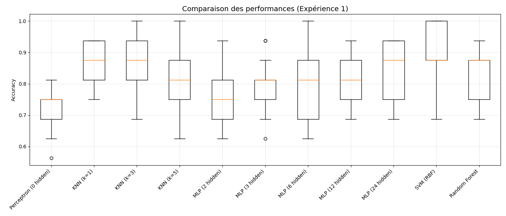
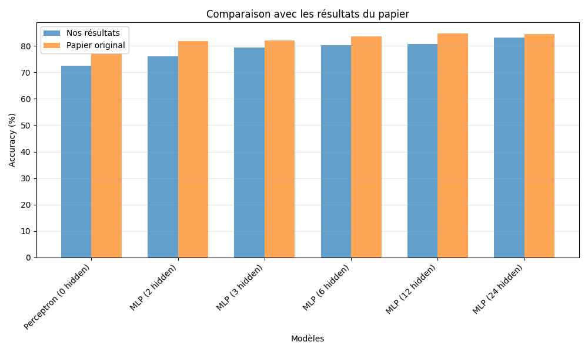
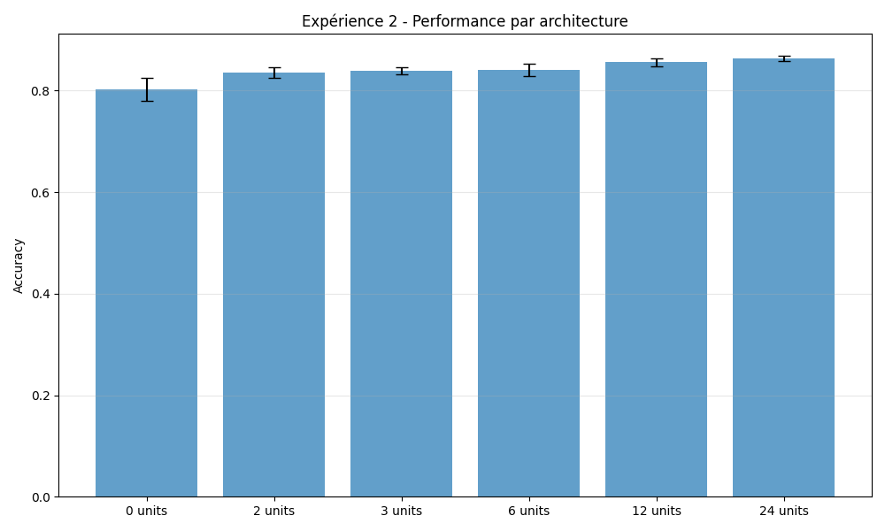
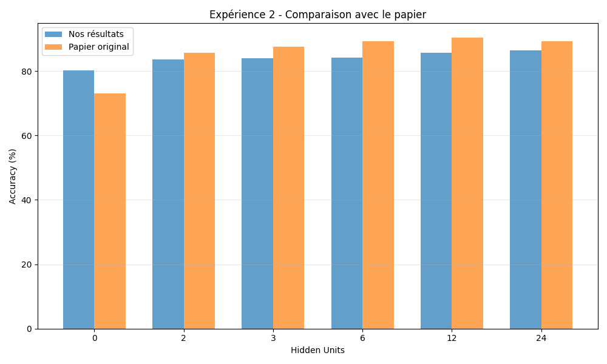

# PROJET SONAR - RAPPORT FINAL
## Classification Mines vs Roches

### Équipe
- **Personne 1** (Data Engineer) : Structure, preprocessing
- **Personne 2** (Exp1 Basic) : Perceptron, KNN
- **Personne 3** (Exp1 Advanced) : MLP
- **Personne 4** (Exp2) : Parsing, split angle-dépendant
- **Personne 5** (Visualisation) : Graphiques, analyse

---

## 1. Introduction

Le dataset Sonar (Gorman & Sejnowski, 1988) contient 208 signaux sonar
(60 fréquences chacun) avec 2 classes :
- **M** : Mine (cylindre métallique) - 111 échantillons
- **R** : Roche - 97 échantillons

Objectif : Classifier correctement ces signaux.

---

## 2. Méthodologie

- **Prétraitement** : standardisation (`StandardScaler`) placée *dans* un `Pipeline` scikit-learn,
  donc ajustée uniquement sur les données d'entraînement de chaque fold (pas de fuite de données).
- **MLP** : une couche cachée, activation logistique, Adam (`learning_rate_init=0.01`, `alpha=0.01`).
  Un taux d'apprentissage de 2.0 (version précédente) faisait diverger le réseau.
- **Graine** fixe (42) ; code reproductible via `python main.py --exp all`.

---

## 3. Expérience 1 - Indépendant de l'angle

Protocole : validation croisée stratifiée K=13.

| Modèle | Accuracy | Écart-type | Papier |
|--------|----------|------------|--------|
| Perceptron | 72.60% | ±7.16% | 77.1% |
| KNN (k=1) | 86.54% | ±6.87% | - |
| KNN (k=3) | 85.58% | ±8.27% | - |
| KNN (k=5) | 83.65% | ±10.27% | - |
| MLP (2) | 75.96% | ±10.06% | 81.9% |
| MLP (3) | 79.33% | ±8.63% | 82.0% |
| MLP (6) | 80.29% | ±11.46% | 83.5% |
| MLP (12) | 80.77% | ±8.99% | 84.7% |
| MLP (24) | 83.17% | ±9.62% | 84.5% |
| **SVM (RBF)** | **89.42%** | ±8.97% | - |
| Random Forest | 83.65% | ±7.96% | - |

---

## 4. Expérience 2 - Dépendant de l'angle

Protocole : split fixe 104 train / 104 test, 10 runs (graines différentes) par architecture.

- Roches : les 97 signaux de `sonar.rocks.txt` sont associés aux lignes du CSV par égalité des vecteurs ;
  les 55 marqués `*` forment l'entraînement, les 42 autres le test.
- Mines : `sonar.mines` n'étant pas fourni, 49 mines sont tirées au hasard (graine fixe) pour l'entraînement
  et 62 pour le test. **Ce split est donc une approximation de celui du papier.**

| Units | Notre accuracy | Papier | Différence |
|-------|----------------|--------|------------|
| 0 | 80.29% (±2.24) | 73.1% | +7.19% |
| 2 | 83.56% (±1.00) | 85.7% | -2.14% |
| 3 | 83.94% (±0.75) | 87.6% | -3.66% |
| 6 | 84.13% (±1.24) | 89.3% | -5.17% |
| 12 | 85.58% (±0.74) | 90.4% | -4.82% |
| 24 | 86.35% (±0.58) | 89.2% | -2.85% |

---

## 5. Analyse

- **Exp1** : le SVM RBF est le meilleur modèle (89.4%), devant KNN k=1 (86.5%). Les écarts-types
  (7 à 11 points) sont élevés : avec ~16 échantillons par fold, la différence entre SVM, KNN k=1 et
  MLP 24 n'est pas statistiquement établie.
- **MLP** : la précision croît avec le nombre d'unités cachées (76% -> 83%), comme dans le papier,
  mais reste 1 à 6 points en dessous.
- **Exp2** : la même tendance apparaît (80% -> 86%) avec des écarts-types faibles ; les MLP
  restent 2 à 5 points sous le papier. Le perceptron fait mieux (+7 points), le split des mines étant approximatif.
- **Correction importante** : la version précédente donnait ~66% en Exp2 (classe majoritaire) à cause
  d'un taux d'apprentissage divergent et d'un split erroné ; ces résultats ne sont plus valables.

---

## 6. Conclusion

Après corrections, les résultats reproduisent qualitativement ceux de Gorman & Sejnowski (1988) :
les réseaux avec couche cachée dépassent le perceptron et la performance augmente avec la taille de la couche.
Les écarts restants avec le papier s'expliquent en partie par l'optimiseur, la normalisation et le split
approximatif des mines en Exp2.

**Date :** Novembre 2026
